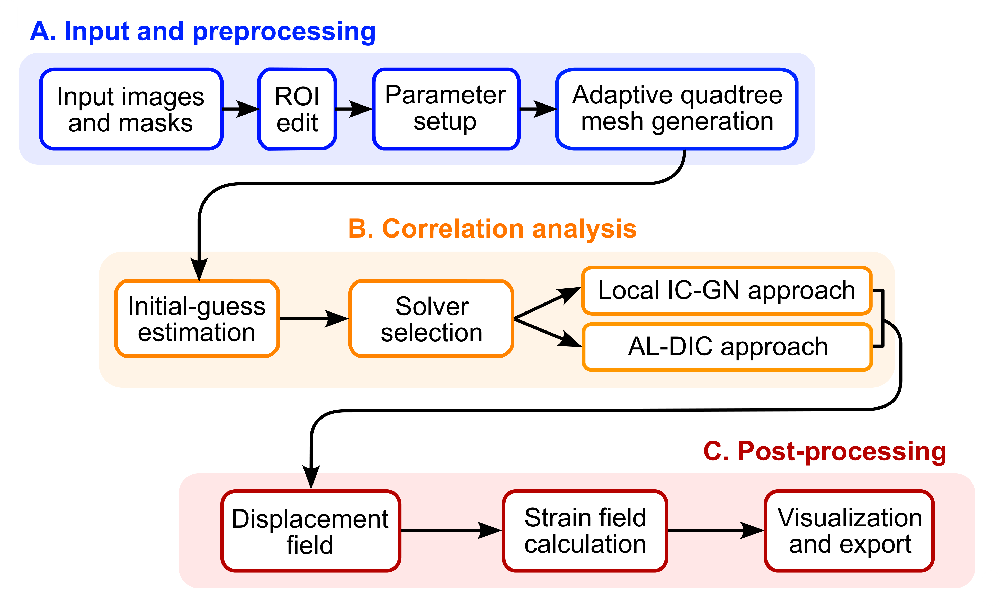

# Summary

Digital Image Correlation (DIC) is widely used in experimental mechanics for measuring full-field deformations [@sutton2009; @pan2018review; @idics_gpg_2018]. Local subset-based image tracking methods (e.g., the inverse-compositional Gauss–Newton (IC-GN) algorithm [@baker2004lucas; @pan2013fast]) are widely used because of their computational efficiency. However, their performance degrades under challenging conditions, including low signal-to-noise images [@yang2019combining], large displacement gradients [@gupta2024estimation], and discontinuous kinematic fields such as cracks [@poissant2010novel; @zhu2026pf], shear bands [@chen2017active; @ni2025revisiting; @ran2026comparative], and interfacial debonding or sliding [@rubino2019full]. To address these challenges, we introduced a hybrid local–global DIC formulation, called **Augmented Lagrangian DIC (AL-DIC)** [@yang2019augmented], in which independent local correlation problems are coupled to a global solver through the alternating direction method of multipliers (ADMM) [@boyd2011distributed]. The global step enforces kinematic compatibility, suppresses noise, and reduces isolated erroneous solutions [@yang2019combining]. The performance of AL-DIC has been evaluated using the DIC Challenge 2.0 datasets and compared with other commercial and academic DIC codes [@dicchallenge2exme]. The AL-DIC formulation has been extended through adaptive spatial discretization to enhance its computational efficiency [@yang2021fast; @yang2018fast; @yang2022staq; @leu2026machine].

**pyALDIC** is an open-source Python package for 2D DIC that makes AL-DIC available through both a desktop graphical user interface (GUI) and a programmatic interface (\autoref{fig:overview}). Users can import image sequences, define regions of interest, select local subset-based DIC or AL-DIC, inspect full-field results, and export displacement and strain data. pyALDIC is distributed under the BSD-3-Clause license, with installation through PyPI (`pip install al-dic`), source code and documentation on GitHub <https://github.com/zachtong/pyALDIC>.

{ width=85% }

# Statement of need

Subset-based DIC is efficient, but neighboring subsets are typically solved independently; noisy images and strong deformation gradients can therefore produce inconsistent measurements. A further difficulty occurs when a square subset spans a crack or hole boundary, so that the pixels within it may not share a single physically meaningful motion.

AL-DIC addresses the trade-off between local correlation and global kinematic consistency [@yang2019augmented]. Adaptive refinement and discontinuity-aware treatment extend this approach to complex specimen geometries [@yang2021fast; @yang2018fast; @yang2022staq; @leu2026machine]. However, the original research implementations were developed primarily in MATLAB. pyALDIC targets experimental mechanicians, materials researchers, and developers who need a freely available Python implementation that can be used interactively in the laboratory or incorporated into reproducible analysis pipelines.

# State of the field

Several open-source DIC software packages have been developed. Ncorr provides a MATLAB-based graphical interface for subset-based DIC analysis [@blaber2015ncorr], while DICe offers a high-performance C++ framework for image correlation [@turner2015dice]. OpenCorr provides an extensible C++ library supporting two-dimensional DIC, stereo-DIC, and digital volume correlation (DVC) [@jiang2023opencorr]. Within the Python ecosystem, μDIC implements a global DIC formulation based on B-spline discretization [@olufsen2020mudic], whereas iCorrVision-2D provides a graphical workflow for subset-based correlation and displacement-field post-processing [@de2022icorrvision]. \autoref{tab:comparison} summarizes selected features of representative packages.

pyALDIC distinguishes itself by providing an open-source Python implementation of the AL-DIC formulation. Beyond implementing the original AL-DIC algorithm, pyALDIC integrates adaptive quadtree meshing, mask-aware subset splitting for displacement discontinuities, and both graphical and scriptable analysis workflows within a unified package. By making the AL-DIC framework accessible within the Python ecosystem, pyALDIC complements existing open-source DIC software and supports its broader adoption in experimental mechanics.

---------------------------------------------------------------------------------------------------------------------------
Package                              Language            GUI         Local         Global       Adaptive      Mask-aware
                                                                     method        method         mesh         subsets
------------------------------------ ---------------- ---------- ------------- ------------- ------------- ----------------
Ncorr [@blaber2015ncorr]             MATLAB           Yes        Yes           No            No            Partial

DICe [@turner2015dice]               C++              Yes        Yes           Yes           No            Partial

μDIC [@olufsen2020mudic]             Python           No         No            Yes           No            No

OpenCorr [@li7088402opencorr]        C++              Yes        Yes           No            No            No

iCorrVision-2D [@de2022icorrvision]  Python           Yes        Yes           No            No            No

UFreckles [@rethore2018ufreckles]    MATLAB           Yes        No            Yes           Yes           No

YaDICs [@yadics]                     C++              No         Yes           Yes           No            No

PReDIC [@predic]                     Python           No         Yes           No            No            No

ALDIC [@yang2019augmented]           MATLAB           No         Yes           Yes           No            No

**pyALDIC (this work)**              **Python**       Yes        Yes           Yes           Yes           Yes
[@pyaldic_zenodo]
---------------------------------------------------------------------------------------------------------------------------

: Comparison of representative open-source DIC software packages. "Local method" and "Global method" indicate whether a package provides a local subset-based correlation formulation, a global finite-element or regularized formulation, or both. "Mask-aware subsets" denotes treatment of correlation subsets that intersect mask boundaries associated with cracks, holes, or ROI boundaries; "Partial" indicates that masked pixels can be excluded from the correlation calculation, whereas "Yes" indicates connected-component-based subset splitting that retains only the valid region containing the subset center.\label{tab:comparison}

# Software design

pyALDIC separates its PySide6 GUI from the computational core, which comprises modules for image input, region-of-interest (ROI) definition, mesh generation, image correlation, strain calculation, visualization, and data export. This modular architecture enables the same analysis procedures to be accessed through either the desktop application or the Python API. Input supports TIFF, PNG, BMP, JPEG, JPEG 2000, and WebP image sequences; outputs include numerical data in NumPy, MATLAB, and CSV formats, as well as figures, animations, and HTML reports.

The correlation solver uses the IC-GN algorithm for subpixel displacement estimation within individual subsets [@baker2004lucas; @pan2013fast]. Two solver modes are available. In *Local DIC* mode, subsets are correlated independently. In *AL-DIC* mode, the local estimates are coupled to a global finite-element displacement field through an augmented-Lagrangian formulation solved using ADMM [@yang2019augmented; @boyd2011distributed]. Providing both modes allows users to balance computational cost against the additional spatial coupling offered by AL-DIC.

pyALDIC incorporates adaptive refinement of a four-node quadrilateral (Q4) mesh [@yang2021fast; @yang2022staq]. Refinement can be guided by mask or ROI boundaries and by user-defined regions; hanging-node constraints accommodate transitions between refinement levels. Near cracks, holes, or other masked boundaries, each correlation subset is restricted to the connected valid-pixel component containing its center. This mask-aware procedure avoids matching pixels from disconnected material regions and flags subsets with insufficient valid pixels, building on established discontinuity-aware DIC strategies [@poissant2010novel; @yang2022staq]. Initial displacements are estimated either by fast Fourier transform (FFT)-based cross-correlation [@jiang2015path] or by propagating estimates from user-defined seed points along mask-connected paths.

Computationally intensive operations are accelerated using Numba just-in-time compilation [@lam2015numba], which avoids a separate user-managed compilation step but introduces an initial compilation overhead. Chunked cross-correlation searches also reduce peak memory requirements for large image sequences.

# Research impact statement

The research value of pyALDIC builds on the established AL-DIC framework. To date, AL-DIC has been adopted across multiple research areas, including studying metals and alloys deformation mechanisms and plasticity [@ni2025revisiting; @ran2026comparative; @ni2024automated; @ni2025temperature; @ozdur2021residual; @gu2026electric; @ni2025mapping; @zhang5993534statistical; @he2026mapping; @hu2026oxygen; @makinen2022detection], laser welding of alloys [@pamarthi2023tailoring], cyclic behaviors of shape memory alloys [@chen2023cyclic], composites [@khouchani2024effect; @mammadli2025universal; @salian2021comparative; @roach2025multiscale], additive manufacturing and architected materials [@jirousek2023design; @jirousek2024discovering; @ye2024experimental; @fry2023tensile; @falta2018; @li2025characterization], soft materials and tissue mechanics [@summey2023open; @roy2025toughening; @sarkar2022quantification; @pearce2024evaluation; @tao2024experimental; @zhou2025vaginal; @yang2021smart; @mcghee2023high; @yang2026inertial; @yang2025imac; @bu2024high; @wei2026machine], civil/geophysics/wood and other construction materials [@harmal2023bioinspired; @grubii2023impact; @grubii2023measurement; @grubii2023influence; @falta2023mechanical; @grubii2023quality; @hafiz2025uniaxial], batteries and energy materials [@wu2023deformation; @courant2024design], fluid, electromagnetic and other physics [@zhang2023pattern; @zhang2025transitional; @leon2022influence; @zhang2025free]. It has also served as a benchmark for emerging DIC algorithms and has been included in community evaluations [@YangR3DICnet; @Ma21; @FENG2024108267; @kafka2024technique; @YANG2025115908; @gupta2024situ; @feng2026stereo; @Mangileva2024; @PUREZA2026102532; @schweickhardt2023digital; @venter2025sun; @wang2026interpretable; @yang2022serialtrack; @tong2026raftcorr] and reviews of open-source DIC software [@jin2023recent; @kopiika2024digital; @naufal2024digital; @kibrete2025free].

pyALDIC makes this methodology accessible through a publicly distributed, reproducible Python package with documented analysis workflows. pyALDIC itself has been used by an independent research group to measure the anisotropic fracture of bedded shale under in-situ SEM three-point bending [@zhang2026anisotropic], and by the authors as a comparison baseline for a learning-based digital volume correlation method [@tong2026raftdvc]. It is also used in teaching: undergraduate laboratory courses at The University of Texas at Austin adopted it in 2026 (ASE 324L in spring and ASE 375 in fall). The repository additionally provides more than 2,600 unit and integration tests and continuous-integration checks on Linux with Python 3.10–3.14.

Representative benchmarks for version 1.0.3 show that, after just-in-time compilation, a complete two-frame analysis of $512\times512$ and $1024\times1024$ pixel images processed approximately 13,500–14,000 points of interest per second with the Local DIC solver and 3,300–3,400 with the AL-DIC solver (three ADMM iterations). These measurements used $31\times31$-pixel subsets, an eight-pixel spacing, and a 24-thread Intel Core i7-13700F CPU. For a $4096\times4096$-pixel, three-frame benchmark, chunked initial-guess computation reduced peak memory usage from 36 GiB in version 0.4.1 to 12 GiB. These results are specific to the reported hardware and parameter settings; the benchmark scripts are included in the repository.

The parameter definitions, ROI conventions, refinement settings, and error-reporting outputs in pyALDIC are designed to be consistent with the iDICs *Good Practices Guide for Digital Image Correlation* [@idics_gpg_2018; @idics_gpg_2025].

Contributions, feature requests, and issue reports are welcome through the project's GitHub Issues and Discussions pages.

# AI usage disclosure

- **Software and documentation.** Anthropic Claude models, used through the Claude Code agentic coding tool, assisted with code generation and refactoring, debugging, test scaffolding, documentation and user-guide drafting, and translation of the graphical interface into seven languages. Session records kept since July 2026 show Claude Opus 4.8, Opus 5, Opus 5.5, Sonnet 5, and Fable 5 and 5.1; the versions used before July 2026 were not recorded. No other AI coding tools were used.
- **Paper.** OpenAI ChatGPT (GPT-6) assisted with manuscript drafting and language editing.

The authors framed the problem and made the core design decisions, including the AL-DIC formulation, the software architecture, mask-aware subset splitting, and the adaptive meshing strategy. All AI-assisted code, documentation, references, and figures were reviewed, edited, and validated by the authors; AI-assisted code was accepted only after review and after passing the automated test suite. The authors take full responsibility for the accuracy, integrity, and scientific content of the software and the manuscript.

# Acknowledgements

J.Y. acknowledges support from the U.S. National Science Foundation (grants CMMI 2232428, 2441460, and 2452029), the U.S. Office of Naval Research (grant N000142612190, through Dr. Timothy Bentley), and the Pilot Seed Gift from the Semiconductor Research Corporation. Z.T. acknowledges the University Graduate Continuing Fellowship, Graduate Excellence Fellowship, and Professional Development Award from the Cockrell School of Engineering at The University of Texas at Austin.

# References
